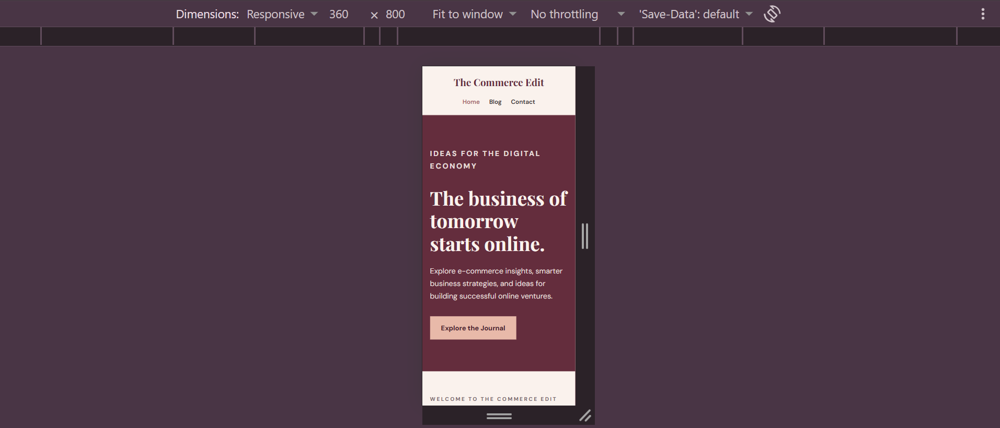
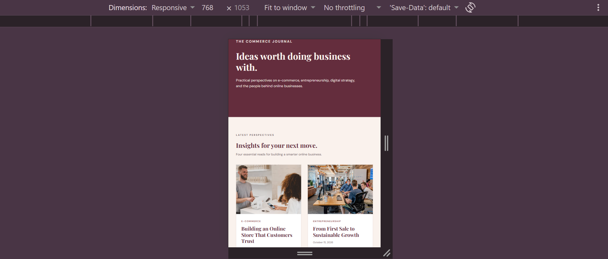
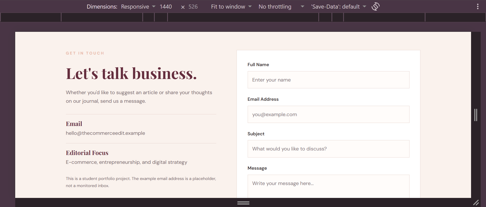

# The Commerce Edit — Multi-Page Blog Website

A modern, responsive business blog website focused on e-commerce, online businesses, and digital entrepreneurship. Designed with an elegant Burgundy & Blush color theme, The Commerce Edit provides a clean and professional reading experience.

## Live Website

[View The Commerce Edit](YOUR-LIVE-WEBSITE-URL)

## About The Project

The Commerce Edit is my third project for **The Sky Gen Web Development Program**.

The purpose of this project was to build a multi-page blog website using HTML5 and CSS3. The website shares insights and articles about e-commerce and online businesses through a simple, elegant, and user-friendly interface.

## Features

- **Three Separate Pages:** Home, Blog, and Contact.
- **Shared Navigation:** Consistent navigation bar across all pages.
- **Active Navigation Links:** Highlights the currently selected page.
- **Home Page:** Includes a hero section, introduction, and link to the blog.
- **Blog Page:** Displays four article cards with images, categories, titles, dates, and descriptions.
- **Contact Page:** Includes contact information and a styled contact form.
- **Responsive Design:** Layout adapts to mobile, tablet, and desktop screens.
- **Consistent Styling:** Burgundy and Blush color palette throughout the website.
- **Interactive Effects:** Hover effects on buttons, links, and article cards.

## Technologies Used

- HTML5
- CSS3
- CSS Flexbox
- CSS Grid
- Google Fonts (DM Sans and Playfair Display)
- Git and GitHub
- VS Code

## Website Pages

### 1. Home Page
Introduces The Commerce Edit with a welcoming hero section and an overview of the website.

### 2. Blog Page
Features four article cards covering topics related to e-commerce and online businesses.

### 3. Contact Page
Provides contact information and a form where visitors can enter their name, email, subject, and message. The form includes HTML validation.

## Responsive Design

The website is designed and tested for different screen sizes:

- Mobile — 360px
- Tablet — 768px
- Desktop — 1440px

## Project Structure

```text
The-Commerce-Edit/
│
├── index.html
├── blog.html
├── contact.html
├── README.md
│
├── css/
│   └── style.css
│
├── images/
│   ├── shoping.jpg
│   ├── meeting.jpg
│   ├── laptop.jpg
│   └── cart.jpg
│
└── screenshots/
    ├── the-commerce-edit-360.png
    ├── the-commerce-edit-768.png
    └── the-commerce-edit-1440.png
```

## Screenshots

### Mobile — 360px



### Tablet — 768px



### Desktop — 1440px



## How to Run Locally

1. Clone this repository:

   ```bash
   git clone YOUR-GITHUB-REPOSITORY-URL
   ```

2. Open the project folder in VS Code.

3. Open `index.html` in your browser, or use the Live Server extension.

## What I Learned

Through this project, I gained practical experience in:

- Creating multi-page websites using HTML5.
- Styling layouts with CSS3, Flexbox, and Grid.
- Maintaining consistent design across multiple pages.
- Building responsive layouts for different screen sizes.
- Organizing website files and folders.
- Using Git and GitHub for version control.

## Author

**Kainat Faisal**

BS Computer Science Student

The Sky Gen Web Development Program — Project 03